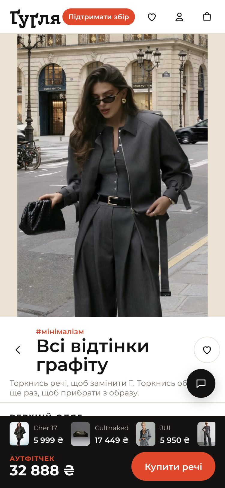
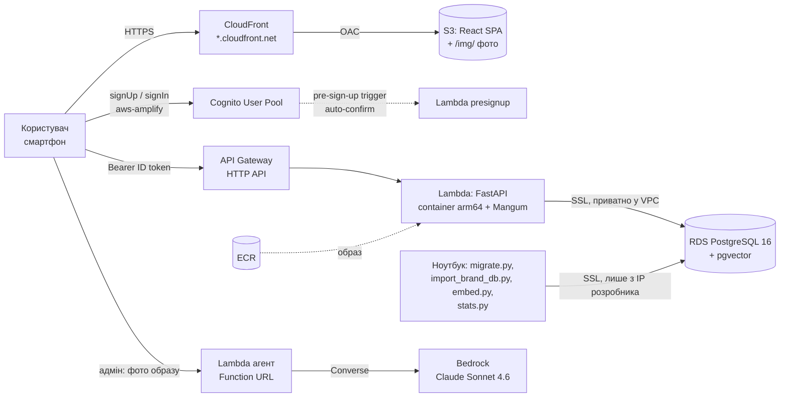

# Ґуґля (Guglya)

> **EN:** Mobile-first website with ready-made trendy seasonal outfits built only from Ukrainian brands' items; AI suggests similar alternatives from other brands, and every click leads to the brand's own product page. React + FastAPI on AWS (Cognito, Lambda, RDS Postgres + pgvector, S3/CloudFront), all in Terraform.

**Ґуґля — сайт із готовими трендовими образами на сезон, зібраними з речей виключно українських брендів.**

Мета: щоб людина виглядала стильно без зусиль і обирала українське. Готові образи, речі в яких пасують одна до одної, показують, як носити тренди цього сезону, і підходять під будь-який бюджет.
**Обираєш образ — і одягаєшся в українське за кілька хвилин.**

- **Для кого:** студенти й молодь 19–35 років у великих містах, які шукають ідеї образів в Instagram/TikTok/Pinterest і купують одяг зі смартфона (72 % онлайн-оплат за одяг). Не хочуть годинами ходити окремими сайтами брендів.
- **Перша версія:** образи на осінь; для кожної речі AI підбирає схожі альтернативи в **інших** українських брендів; видно ціну кожної речі й суму образу; клік відкриває сторінку товару на сайті бренду, де й відбувається покупка.
- **Формат «АутфітЧек»:** як у наших коротких відео в TikTok/Reels: образ, бренд і ціна кожної речі, загальна сума.
- **Валідація:** показуємо прототип 20–30 потенційним користувачам і 10 брендам. Ключова метрика: частка тих, хто переглянув образ і перейшов на товар бренду (ціль ≥ 1 із 10).

**Команда:** Андрій Гуменюк, Тарас Коновал (Український католицький університет).

**Демо:** https://guglya.studio · **API:** https://bn43uwfr9f.execute-api.eu-central-1.amazonaws.com/health

> **Каталог:** реальні товари **37 українських брендів — 7 469 речей** (одяг, взуття, головні убори) з цінами в гривнях, зібрані з сайтів брендів (див. [docs/catalog.md](docs/catalog.md)). Образи збираємо самі в адмінці `/admin`: фото образу → AI знаходить схожі речі в каталозі → перевіряємо й публікуємо. Покупка відбувається на сайті бренду (перехід із кошика).
> **Фото брендів:** факультет погодив із бізнесами показ фото товарів на етапі студентського проєкту; перед публічним запуском пишемо кожному бренду окремо (шаблон листа в docs/catalog.md).

| Стрічка | Образ і заміни | АутфітЧек |
| --- | --- | --- |
|  |  |  |


## Як працює AI-підбір

1. Для кожного фото товару офлайн рахуємо ембединг моделлю **FashionCLIP** (`patrickjohncyh/fashion-clip`, CLIP, донавчений на фото одягу): нормалізований вектор на 512 чисел, що кодує крій, колір і фактуру (`backend/ml/embed.py`). Ним же сортуємо «унісекс»-товари на жіночі/чоловічі (`classify_gender.py`).
2. Вектори зберігаються в Postgres у колонці `products.embedding` (розширення **pgvector**).
3. `GET /outfits/{id}/similar/{slot}` бере оригінальну річ образу й шукає найближчі за косинусною відстанню (`<=>`) речі **того ж виду** (брюки ≠ спортивні штани ≠ джинси, лофери ≠ черевики ≠ кросівки; увесь слот — лише якщо такого виду < 3), що є в наявності, **лише в інших брендів** (спершу по одній від кожного), для статі образу; схожість ≥ 0.6; бонуси за той самий тип речі й популярність бренду (Instagram + наші кліки). Є фільтр кольору й різниця в ціні з оригіналом.
4. **Конструктор образів** (`/admin`, лише група Cognito `admins`): фото образу → Claude Sonnet 4.6 (Amazon Bedrock) перелічує речі (слот, тип, колір, опис англійською, назва й тег образу) → FashionCLIP перетворює опис у вектор → пошук по каталогу → адмін перевіряє, замінює й публікує.

## Архітектура



- **Auth:** Cognito (email + пароль від 8 символів). Pre-sign-up Lambda одразу підтверджує акаунт, тож тестувальник входить без коду з пошти.
  Також «Продовжити з Google»: Cognito федерує вхід через Google OAuth (домен `auth.guglya.studio`, Amplify `signInWithRedirect`).
- **Backend:** FastAPI у Lambda (VPC за замовчуванням, без NAT), тому JWKS Cognito і `DATABASE_URL` Terraform передає як змінні середовища. Токен перевіряється за RS256 / `iss` / `aud` / `token_use=id`. CORS налаштований лише у FastAPI.
- **Дані для звіту:** `users` (кожен запит із токеном оновлює рядок), `events` (`outfit_view`, `swap`, `donate_click`, `feedback_open`), `clicks` (з позначкою `is_alternative`), `feedback` (оцінка, «чи купили б», текст).

### Структура репозиторію

```
backend/            FastAPI (app/), Lambda handler, Dockerfile (локально) і Dockerfile.lambda
  agent/            Lambda-агент конструктора образів (Bedrock + FashionCLIP), infra/deploy-agent.sh
  ml/               import_brand_db.py (каталог брендів → БД), embed.py (FashionCLIP → pgvector),
                    classify_gender.py, import_catalog.py (демо)
  scripts/          migrate.py (міграції), stats.py (цифри для звіту)
frontend/           React + Vite + TypeScript, aws-amplify v6
infra/
  terraform/        уся AWS-інфраструктура (Cognito, RDS, Lambda, API GW, S3, CloudFront, ECR, SSM, Budget)
  db/migrations/    SQL-схема
  deploy-backend.sh, deploy-frontend.sh, seed-demo.sh, docker-compose.yml
data/database/      збирач каталогу (scrape.mjs + scraper.js, Андрій), brands.json, brand_popularity.json,
                    merge.py → products.json (див. docs/catalog.md)
data/demo/          старий демо-каталог (приховано на сайті)
docs/               шаблон звіту, скріншоти
```

## Локальний запуск

Потрібно: Node 20+, Python 3.12+, Docker, AWS CLI. Інфраструктура вже розгорнута (див. «Деплой»), локально запускаємо лише код, який ходить у ту саму RDS (ваш IP має бути в `my_ip_cidr`).

```bash
export AWS_PROFILE=guglya AWS_REGION=eu-central-1
cd infra/terraform && terraform output && cd ../..

# Backend
cd backend
cp .env.example .env    # DATABASE_URL: aws ssm get-parameter --name /guglya/database_url --with-decryption --query Parameter.Value --output text
                        # COGNITO_USER_POOL_ID / COGNITO_CLIENT_ID з terraform output
python -m venv .venv && source .venv/bin/activate
pip install -r requirements.txt
uvicorn app.main:app --reload          # http://localhost:8000/docs
# або: docker compose -f infra/docker-compose.yml up --build

# Frontend
cd frontend
cp .env.example .env    # VITE_* з terraform output; VITE_API_URL=http://localhost:8000; VITE_ASSET_BASE_URL=https://guglya.studio
npm install && npm run dev             # http://localhost:5173
```

## Деплой (з нуля)

```bash
export AWS_PROFILE=guglya              # IAM-користувач з правами адміністратора (не root)
cd infra/terraform
cp terraform.tfvars.example terraform.tfvars   # email для бюджету + ваш IP: echo "$(curl -s https://checkip.amazonaws.com)/32"
# Вхід через Google (необовʼязково): Google Cloud Console → OAuth client (Web application),
#   Authorized JavaScript origin = https://<cognito_domain>, redirect URI = terraform output google_redirect_uri;
#   google_client_id / google_client_secret → terraform.tfvars, потім terraform apply і deploy-frontend.sh
terraform init

# a) Cognito, S3 + CloudFront, ECR, бюджет
terraform apply -target=aws_cognito_user_pool_client.web -target=aws_lambda_permission.cognito_presignup \
  -target=aws_iam_role_policy_attachment.presignup_logs -target=aws_s3_bucket_policy.frontend \
  -target=aws_s3_bucket_public_access_block.frontend -target=aws_ecr_lifecycle_policy.backend -target=aws_budgets_budget.monthly
# b) RDS + security groups + SSM (~10 хв)
terraform apply -target=aws_ssm_parameter.database_url -target=aws_ssm_parameter.db_password
cd ../..
infra/deploy-backend.sh                # перший образ у ECR
terraform -chdir=infra/terraform apply # c) Lambda + API Gateway

pip install -r backend/requirements-ml.txt   # у backend/.venv
infra/seed-demo.sh                     # міграції, фото → S3 /img/, демо-каталог, ембединги
VITE_DONATE_URL=https://send.monobank.ua/jar/XXXX infra/deploy-frontend.sh
```

Власний домен: `domain_name` у `terraform.tfvars` → `terraform apply` → у реєстратора вказати nameservers з `terraform output name_servers` → `domain_delegated = true` → `terraform apply` (ACM-сертифікат, CloudFront, `www` і `*.cloudfront.net` → редирект на домен, `auth.<домен>` для Cognito; додайте `https://auth.<домен>` і `/oauth2/idpresponse` у Google OAuth client).

Оновлення коду: `infra/deploy-backend.sh` (білд arm64 → ECR → Lambda → перевірка `/health`) і `infra/deploy-frontend.sh` (білд → S3 → інвалідація CloudFront). Змінився IP ноутбука? Оновіть `my_ip_cidr` у `terraform.tfvars` і виконайте `terraform apply`.

## Каталог брендів

Повний опис і чек-лист нового бренду: **[docs/catalog.md](docs/catalog.md)**. Коротко:

```bash
cd data/database && npm ci
node scrape.mjs --out <папка> --only <id>        # бренд із brands.json → <папка>/guglya_<id>.json
python3 merge.py <папка> --keep                   # → products.json (решта брендів лишаються)
cd ../..
export DATABASE_URL=$(aws ssm get-parameter --name /guglya/database_url --with-decryption --query Parameter.Value --output text)
backend/.venv/bin/python backend/ml/import_brand_db.py   # бренди + товари (лише ціни в ₴, без аксесуарів і російських назв)
backend/.venv/bin/python backend/ml/embed.py             # FashionCLIP-вектори нових фото
backend/.venv/bin/python backend/ml/classify_gender.py   # унісекс → жіноче/чоловіче за фото
```
Образи: `/admin` на сайті (фото → AI → перевірка → публікація, редагування опублікованих). Старий демо-каталог прихований (`import_catalog.py --purge-demo`), його кліки й події лишились у звіті.

## Статистика для звіту

```bash
python backend/scripts/stats.py                                          # за весь час
python backend/scripts/stats.py --since 2026-11-17 --until 2026-11-18    # раунд 1 (час Києва)
```
Виводить: зареєстрованих користувачів, хто переглянув образ, хто перейшов на бренд, click-through (ціль ≥ 10 %), кліки на AI-альтернативи проти оригінальних речей, кліки по брендах і образах, кліки на «Підтримати збір», кількість відгуків, середню оцінку та розподіл «чи купили б». Шаблон звіту: `docs/report-template.md`.

## Вартість і видалення

Орієнтовно **~$20/міс**: RDS db.t4g.micro (~$13) + 20 GB gp3 (~$2.5) + публічна IPv4-адреса RDS (~$3.6) + Route 53 зона ($0.50). Lambda, API Gateway, Cognito (до 10 000 MAU), S3, CloudFront і ECR на нашому обсязі коштують центи. На новому акаунті частину покриває Free Tier. Бюджет-алерт на $30/міс надсилає листи на 50/80/100 %.

Видалити все:
```bash
terraform -chdir=infra/terraform destroy    # RDS без фінального снапшоту; S3 і ECR очищаються автоматично
```

## API

| Метод | Шлях | Auth | Що |
| --- | --- | --- | --- |
| GET | `/health` | — | перевірка |
| GET | `/outfits?season=autumn` | — | стрічка: образи із сумою та прев'ю речей |
| GET | `/outfits/{id}` | — | образ з оригінальними речами по слотах |
| GET | `/outfits/{id}/similar/{slot}?color=&limit=5` | — | AI-альтернативи (pgvector) з різницею ціни |
| GET | `/products/{id}` | — | товар |
| GET/PUT | `/me` | так | профіль (імʼя, прізвище, телефон) |
| GET/POST/DELETE | `/cart[/{product_id}]` | так | кошик; з нього — перехід на сайт бренду |
| POST | `/admin/match` | admins | товари каталогу для вектора речі (конструктор) |
| GET/POST/PUT/PATCH | `/admin/outfits[/{id}]` | admins | створити / редагувати / сховати образ, обкладинка |
| PATCH | `/admin/products/{id}` | admins | сховати товар з каталогу |
| POST | `/clicks` | опц. | логує клік, повертає URL бренду з UTM |
| POST | `/events` | опц. | `outfit_view` / `swap` / `donate_click` / `feedback_open` |
| GET/POST/DELETE | `/saved[/{outfit_id}]` | так | збережені образи |
| POST | `/feedback` | так | оцінка, «чи купили б», текст |
